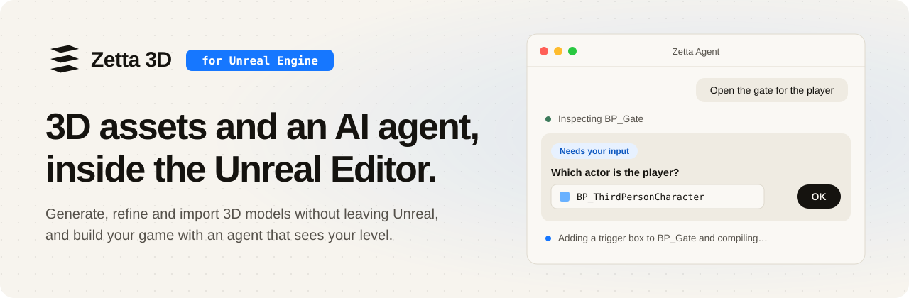
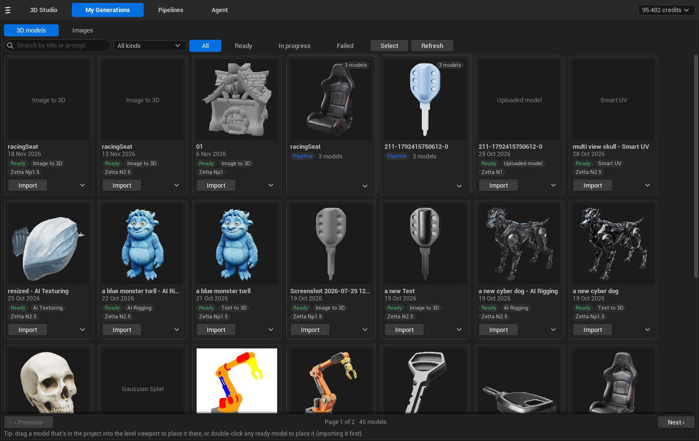
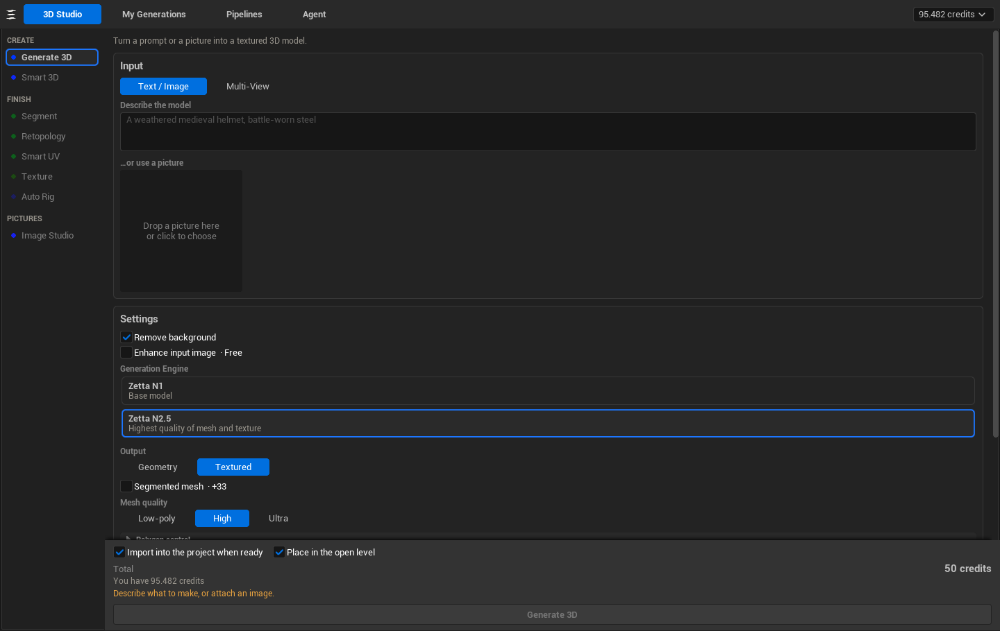
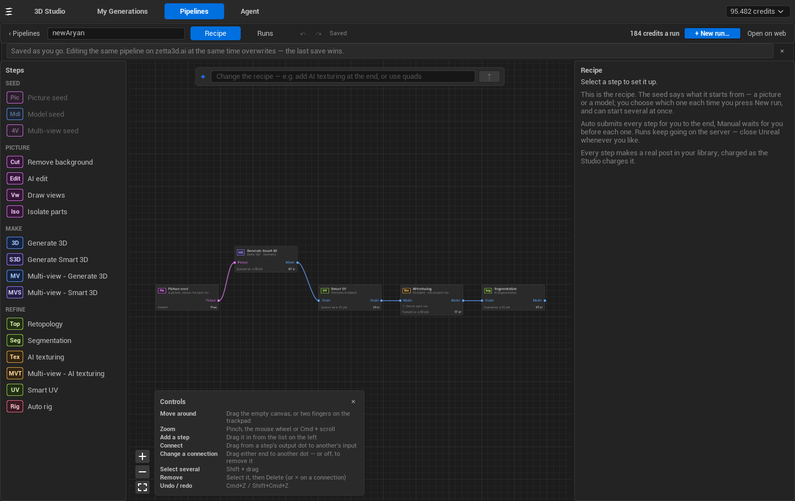
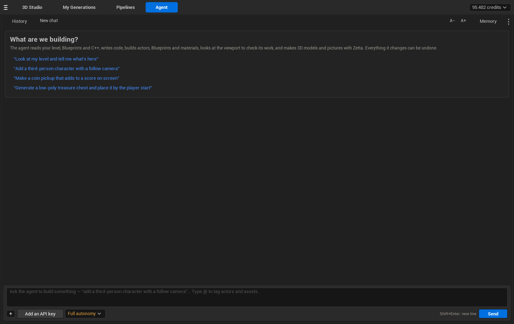
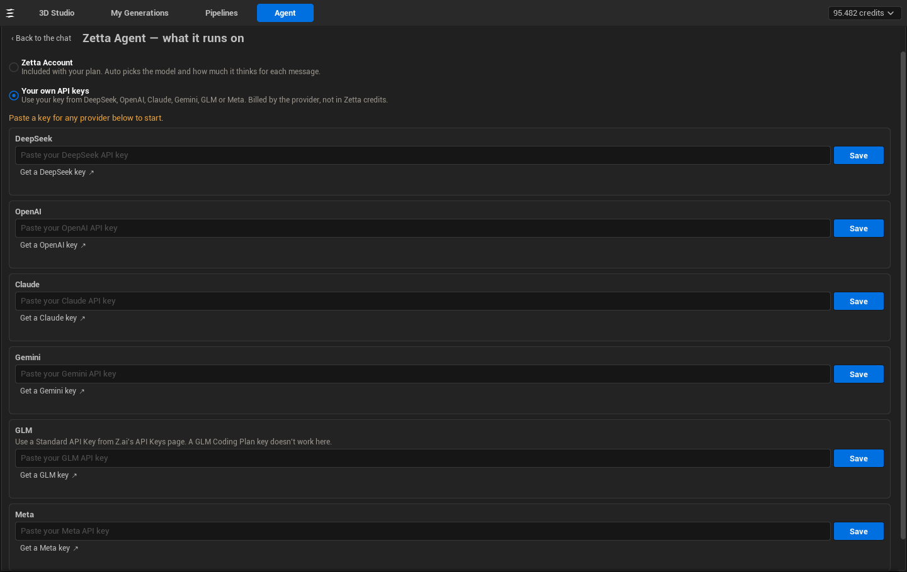

<p align="center">
  <picture>
    <source media="(prefers-color-scheme: dark)" srcset="Docs/images/banner-dark.svg">
    
  </picture>
</p>

<p align="center">
  <a href="#install"></a>
  <a href="#install"></a>
  <a href="#the-zetta-agent"></a>
  <a href="#license"></a>
</p>

<p align="center">
  <a href="#install"><b>Install</b></a> ·
  <a href="#sign-in"><b>Sign in</b></a> ·
  <a href="#3d-studio"><b>3D Studio</b></a> ·
  <a href="#my-generations"><b>My Generations</b></a> ·
  <a href="#3d-pipelines"><b>Pipelines</b></a> ·
  <a href="#the-zetta-agent"><b>Agent</b></a> ·
  <a href="#your-own-api-key"><b>Own API key</b></a> ·
  <a href="https://zetta3d.ai"><b>zetta3d.ai</b></a>
</p>

<br>

**Zetta 3D for Unreal Engine** puts your [Zetta 3D](https://zetta3d.ai) account inside the Unreal Editor. Use it to:

- **make 3D models** from text, a picture or several views, and finish them — retopology, segmentation, UVs,
  texturing and rigging, with rigs on the **UE5 Mannequin skeleton**;
- **bring them into your project** in one click — imported with Unreal's own importers and, if you like, placed in the
  open level resting on the ground;
- **chain the tools into pipelines** that run over many pictures or models at once;
- **build your game with the Zetta Agent**, an assistant that reads your level, Blueprints and C++, spawns and edits
  actors, builds Blueprints and materials, compiles your code, looks at the viewport to check its work, and makes the
  art it needs — on your Zetta account, or on [your own API key](#your-own-api-key).

Everything you make is also in your library on zetta3d.ai, and everything you made there shows up in Unreal.

<p align="center">
  
</p>

## Install

**You need:** Unreal Engine **5.8** on Windows, macOS or Linux, and a [Zetta 3D](https://zetta3d.ai) account.

**From a release (recommended — works in Blueprint-only projects).**

1. Download the zip for your engine version and platform from [Releases](../../releases).
2. Unzip it into your project's `Plugins` folder, so you have `YourProject/Plugins/Zetta3D/Zetta3D.uplugin`.
   (To have it in every project, unzip it into the engine's `Engine/Plugins/Marketplace/` instead.)
3. Open the project. The **Zetta 3D** window opens on its own.

**From source (C++ projects).** Clone this repository into `YourProject/Plugins/Zetta3D` and open the project; Unreal
offers to build the plugin. You need your engine's C++ toolchain (Visual Studio on Windows, Xcode on macOS).

The plugin switches on the engine plugins it uses — Python Editor Script Plugin, Editor Scripting Utilities and
Enhanced Input. GLB and FBX models import with the engine's own importers.

**Remove.** Delete `Plugins/Zetta3D`. Models you imported stay in your project.

## Sign in

In the **Zetta 3D** window, click **Sign in with your browser**, sign in on zetta3d.ai and click
**Connect Unreal Engine**. That's it — the editor receives its own session and never sees your password. The session is
kept in your system's key store (macOS Keychain, Windows Credential Manager, or a private file on Linux), never in the
project, so it can't end up in version control.

Everything is in one **Zetta 3D** window, with a tab for each part in its header —
**3D Studio · My Generations · Pipelines · Agent**. Open it from **Window › Zetta 3D** or the **Zetta 3D** button on
the level editor's toolbar, and dock it wherever you like. Each tab keeps its place while you switch.

## 3D Studio

Every tool from the web Studio, docked in the editor — with live prices and your plan's options.

<p align="center">
  
</p>

| Tool | What it does |
|---|---|
| **Generate 3D** | Text, a picture or several views → a 3D model, on Zetta N1 or N2.5, with every option the web Studio has |
| **Smart 3D** | Clean, game-ready topology from the start, on Zetta Np1 or Np1.5 |
| **Segment** | Split a model into named parts (or let Smart Segment decide them) |
| **Retopology** | Rebuild a mesh at a polygon budget, as triangles or quads |
| **Smart UV** | Lay a model's UVs out again as a clean layout, keeping its textures, rig and animation |
| **Texture** | Re-texture a model from a description or a reference picture, up to 8K |
| **Auto Rig** | Rig humanoids, animals and other creatures — UE5 Mannequin (the default), Standard, Mixamo, Unity Humanoid, VRM or ActorCore bone names; FBX or GLB |
| **Image Studio** | Generate, edit and compose pictures, and save them as textures |

Finished models import into `/Game/Zetta3D/Models/<id>-<name>/` (you can change the folder) and, with
**Place in the open level** on, land in front of the camera, resting on the ground, in the Outliner folder **Zetta 3D**.
Every placement is one step on **Edit › Undo**. Right-click a texture in the Content Browser for **Zetta 3D › Make a 3D
model from this picture**, or a mesh for **Send to a tool**.

## My Generations

Everything you've made on Zetta 3D, on the web or in Unreal.

- **Import** a model with a progress bar. Models already in the project are marked **In project**, with **Show** (in
  the Content Browser) and **Place** — or drag them straight into the level.
- **Send to a tool** (texture it, rig it…), or **Fork** a generation's settings back into Generate.
- Search, filter and bulk delete. A pipeline run shows as one stacked tile that opens its models in run order, with
  **Import all**. Your pictures are in the **Images** tab, ready to save as textures or use for 3D.

## 3D Pipelines

Chain the Studio's tools into a reusable recipe on a node canvas — the same pipelines as on
[zetta3d.ai/pipelines](https://zetta3d.ai/pipelines).

<p align="center">
  
</p>

- **Describe it** — *"a game-ready character from a photo, rigged for Unreal"* — and the recipe is built on the canvas,
  every step wired and set up. Describe a change to an existing recipe the same way.
- Start from a **picture**, a **model**, or **pictures of each side**, then add steps: remove background, AI edit, draw
  views, isolate parts, Generate 3D or Smart 3D, retopology, segmentation, AI texturing, Smart UV and auto rig.
- **Run** a pipeline on up to 20 pictures or models at once, **Manual** or **Auto**. Runs keep going on the server even
  if Unreal is closed; the **Runs** view shows every step's result and imports the finished models.

## The Zetta Agent

A game-development assistant with a real understanding of Unreal Engine, working directly in your open project. Tell it
what you want in plain words, the way you'd brief a teammate — it plans the work, does it in the editor, and checks the
result.

<p align="center">
  
</p>

**What it understands.** Your project (engine version, C++ or Blueprint-only and its modules, rendering features,
Enhanced Input, the default GameMode, plugins), your level (the Outliner — actors, components, properties, folders —
and your selection), your assets and code (Blueprints, materials, meshes, textures, C++ and config, the Output Log),
what things look like (it captures the viewport and looks at the picture), and your Zetta 3D library.

| Area | What it does |
|---|---|
| **Level** | Spawns, moves, renames, reparents, organizes and deletes actors; adds and removes components; sets any property by reflection |
| **Blueprints** | Creates Blueprint classes from any parent, adds components and variables, sets class defaults, reparents, compiles and reports errors |
| **C++** | Writes and edits your source, compiles it in the editor (Live Coding on Windows, hot reload on macOS) and fixes its own errors |
| **Materials** | Creates materials and material instances from colours and textures, and assigns them |
| **Assets** | Finds, imports, moves, renames and deletes assets; saves generated pictures as textures |
| **Testing** | Starts and stops Play In Editor, reads the Output Log, runs console commands, looks at the viewport |
| **Python** | Runs editor Python for anything else — shown to you first, inside safety rules |
| **3D models** | Generates models, runs the finishing tools, then imports and places the results |
| **Pictures & pipelines** | Draws, edits and combines pictures; builds and runs pipelines and imports what they make |

**You stay in charge.** Every change is an editor transaction named after what it did, so **Edit › Undo** takes it
back, and the card under each reply lists what changed with **Undo** and **Keep** per line. **Ask first** (the default)
waits for your OK before it deletes anything, runs Python or spends credits; **Full autonomy** carries the whole request
through on its own. **Ask** mode reads and answers without changing anything. **Stop** (or **Esc**) ends it at once.

**Point it at things.** Type **@** to tag an actor or asset, drag them from the Outliner or Content Browser onto the
chat, or right-click them and choose **Add to Zetta Agent**. Attach a picture of the viewport, pictures, PDFs or text
files with **+**. **A−** / **A+** (or Cmd/Ctrl − and =) change the chat's text size, and **Copy** under any message
copies it as written.

### Your own API key

Run the agent on your own API key, on any plan — **Gemini**, **OpenAI**, **DeepSeek**, **Claude**, **GLM** (Z.ai) or
**Meta** (Muse).

<p align="center">
  
</p>

Open **Editor Preferences › Plugins › Zetta 3D › Your own API keys…** (or the same entry in the Zetta 3D window's
account menu), choose **Your own API keys**, paste a key and click **Save** — it's checked straight away. Then pick the
provider, a model and a thinking level under the message box.

- What the agent uses on your key is billed by that provider, not in Zetta credits. Making 3D models and pictures still
  uses Zetta credits.
- Your key is kept in your system's key store, never in the project or the editor's settings files. It goes to Zetta 3D
  only to run your messages and is never saved on our servers.

## Settings

- **Project Settings › Plugins › Zetta 3D** — the import folders, the preferred mesh format (GLB or FBX), placing models
  in the level, and the project id the agent's memory is tied to. They live in `Config/DefaultZetta3D.ini`: **commit
  that file** so your team shares one project memory.
- **Editor Preferences › Plugins › Zetta 3D** — what the agent runs on, and per-computer settings. Secrets are never
  stored there.

## Building from source

Two editor modules: `Zetta3DEditor` (sign-in, the API client, importing, 3D Studio, My Generations, Pipelines) and
`Zetta3DAgent` (the Zetta Agent and its Unreal tools). [CONTRIBUTING.md](CONTRIBUTING.md) has the layout and
conventions, and [RELEASING.md](RELEASING.md) how a release is packaged:

```bash
Scripts/package.sh "/Users/Shared/Epic Games/UE_5.8"
```

The screenshots in this README come from the plugin itself: run `Zetta.CaptureDocs live` in the editor's console and
they land in `Saved/Zetta3D/DocShots`. The banner is `node Docs/art/readme-art.mjs`.

## License

[Apache License 2.0](LICENSE.md) — use, change and ship it, in free or commercial projects. The software comes as is,
without warranty. The license doesn't cover the Zetta 3D name and logo; see [NOTICE](NOTICE). Using the Zetta 3D
service is governed by its [Terms of Service](https://zetta3d.ai/terms).

Unreal Engine is a trademark of Epic Games, Inc. This plugin is not made or endorsed by Epic Games.
